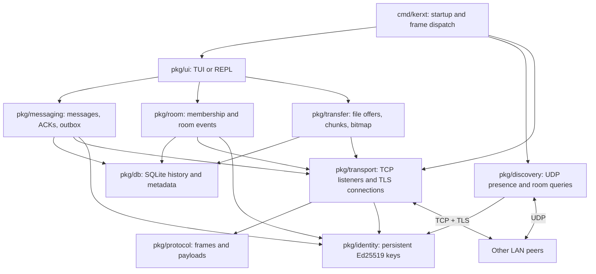
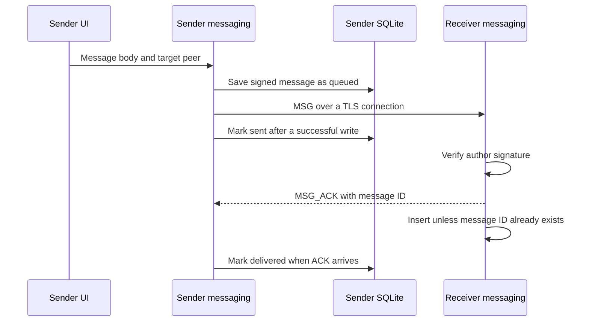

# Kerykeion Terminal

Kerykeion Terminal (`kerxt`) is a terminal application for peer-to-peer chat and file transfers over a local network. Each running instance discovers peers, accepts connections, sends messages, and stores its own history. There is no central server or cloud account.

The application is written in Go. It uses Bubble Tea for the terminal interface, TLS over TCP for connections, UDP for discovery, and SQLite for local state.

The code is source-available under a custom license. Personal use, noncommercial education and research, and internal office or business use are permitted. Selling the application or providing paid access to it is not permitted. See [License](#license) for the terms.

## Project status

This is a development build. Direct messaging and small direct file transfers have an end-to-end test. Room discovery, membership synchronization, automatic transfer reconnection, and room media sharing still need work.

The protocol contains messages for some unfinished flows. Their presence in the code does not mean those features are ready for use across devices. See [Current limitations](#current-limitations) before testing on a shared network.

## Install

You need Git and a Go toolchain compatible with [go.mod](go.mod), which currently declares Go 1.27.3. The installer builds the application from source. It provides Go installation instructions if the compiler is missing.

After cloning or downloading this repository, run these commands from its root:

```bash
bash install.sh
kerxt
```

On Linux, the installer builds `kerxt`, sets executable permissions, and installs it at `~/.local/bin/kerxt`. It checks `PATH` and adds a shell configuration entry when needed. If it changes your shell configuration, follow the printed reload instructions or open a new terminal.

Installer and uninstaller messages are in English. The language setting applies to the TUI.

### Manual Linux build

Install Go and Git with your distribution's package manager:

```bash
# CachyOS / Arch Linux
sudo pacman -S go git

# Fedora
sudo dnf install -y golang git
```

Then build and install:

```bash
mkdir -p ~/.local/bin
go build -ldflags="-s -w" -o ~/.local/bin/kerxt ./cmd/kerxt
```

Make sure `~/.local/bin` is in your shell's `PATH`. To build and run without installing:

```bash
go build -o kerxt ./cmd/kerxt
./kerxt
```

### Cross-compilation

```bash
# Windows, amd64
GOOS=windows GOARCH=amd64 go build -ldflags="-s -w" -o kerxt.exe ./cmd/kerxt

# macOS, Apple Silicon
GOOS=darwin GOARCH=arm64 go build -ldflags="-s -w" -o kerxt-darwin-arm64 ./cmd/kerxt
```

A successful cross-build does not verify runtime behavior, operating-system permissions, or firewall rules on the target machine.

### Uninstall

```bash
# Remove the binary from the default installation location
kerxt uninstall

# Also remove application configuration, history, cache, and downloaded files
kerxt uninstall --purge
```

## Use

```bash
kerxt                  # Open the TUI
kerxt join lounge      # Join or create a room at startup
kerxt --repl           # Use the line-based interface
kerxt doctor           # Print network diagnostics
```

Flags go before the subcommand. For example:

```bash
kerxt --config /tmp/kerxt-alice --name Alice --port 43100 --udp-port 43101
```

`--config` separates identity, history, configuration, and downloads from the default application directories. Two instances using the same directory share the same identity and database; use separate directories for separate test peers.

### Panels and input focus

The TUI starts with the system panel. Opening a room or direct conversation adds the chat panel. The panels are stacked on smaller terminals and placed side by side when space permits. The sidebar is hidden below 100 columns.

The `>` marker in a panel title identifies the current input and scrolling focus.

| Focus | What Enter does |
|---|---|
| System panel | Executes input beginning with `/`; other text stays out of chat |
| Chat panel | Sends the text as a message, including text beginning with `/` |
| Chat minimized | Handles input as system commands |

After opening a chat, press F6 before entering a command such as `/who` or `/leave`. Otherwise that text is sent to the conversation.

| Key | Action |
|---|---|
| F2 | Switch between English and Indonesian; save the preference |
| F6 | Switch input and scrolling focus between system and chat |
| Esc | Cancel an open file picker; otherwise minimize chat |
| F4 | Restore minimized chat; do nothing if chat is already visible |
| PgUp / PgDn | Scroll the focused panel |
| Tab | Complete commands or room names while system input has focus |
| Ctrl+C | Quit |
| Ctrl+O | Open the file picker while chat has focus |

Minimizing chat does not leave the room or disconnect the peer. Messages received for the active conversation remain in its history, and a counter appears while the panel is hidden. F4 reopens it and clears that counter. The F4 hint is hidden while chat is visible.

Each panel has a scrollbar on its right edge. The thick segment shows the visible fraction of its history and moves with the reading position. It is an indicator, not a draggable control.

### Attaching files

To attach a file, focus a conversation and press Ctrl+O. The picker starts in your home directory and remembers the last folder for the current session. It lists one directory at a time, including hidden entries; it does not scan subfolders. The current path and recipient appear above the list.

| Picker key | Action |
|---|---|
| Up / Down | Select an entry |
| PgUp / PgDn | Move by a page |
| Enter / Right | Open a folder or select a file |
| Backspace / Left | Open the parent folder |
| Enter on confirmation | Send the selected file |
| Backspace on confirmation | Return to the file list |
| Esc | Cancel and return to chat |
| Ctrl+C | Quit the application |

Selecting a file shows its path, size, and recipient before sending. Esc preserves your chat draft and keeps the chat panel open. Files must be regular files within the configured size limit. Directory reads and send preparation run outside the UI event loop.

From the system panel, `/send` also accepts a complete path containing spaces, with or without surrounding quotes:

```text
/send ~/Downloads/WhatsApp Image 2026-10-19 at 20.41.48(1).jpeg
/send "/home/aria/Downloads/WhatsApp Image 2026-10-19 at 20.41.48(1).jpeg"
```

Relative paths are resolved from the directory where `kerxt` was launched. `/send` starts sending immediately; it does not open the picker or request confirmation. The line-based interface (`--repl`) supports `/send` with the same path rules, but has no Ctrl+O picker. Paths are not executed as shell commands or expanded using shell variables.

Selecting a file for a room uses the existing room announcement flow; its cross-device limitations still apply.

English is the default TUI language. Use F2, `/lang en`, or `/lang id` to change it. Run slash commands from the system panel.

### Commands

| Command | Action |
|---|---|
| `/help [command]` | Show help, including subcommands such as `/help room transfer` |
| `/who` | List discovered peers and their online/stale status |
| `/dm <peer>` | Open a private conversation by display name or peer ID prefix |
| `/join <room>` | Search for a room; create it if no room is found |
| `/room new <name>` | Create a room explicitly |
| `/room list` | List active local rooms |
| `/room info [name]` | Show room metadata and members |
| `/room transfer <name> <peer>` | Transfer the master role |
| `/go <target>` | Open a joined room or a conversation with a discovered peer |
| `/send <path>` | Send immediately to the active DM or prepare a room announcement; spaces, surrounding quotes, and `~/` are supported |
| `/get <number>` | Request a numbered room file announcement; this flow is unfinished |
| `/leave [room]` | Leave a room locally and notify online members |
| `/disband [room]` | Close a room as its master |
| `/name <new_name>` | Change the display name without replacing the identity |
| `/open <number>` | Open a registered HTTP or HTTPS link in the default browser |
| `/doctor` | Print interface, port, and troubleshooting information |
| `/add <ip:port>` | Send a discovery announcement to a specified host |
| `/lang <id|en>` | Set and save the TUI language |
| `/quit` | Quit from system input |

## Architecture

Each process runs the same components. The entry point in [cmd/kerxt/main.go](cmd/kerxt/main.go) creates them, registers callbacks, and routes incoming frames to the appropriate handler.



| Package | Responsibility |
|---|---|
| [`config`](pkg/config) | Defaults, OS-specific directories, saved settings |
| [`identity`](pkg/identity) | Key creation/loading, peer fingerprints, signatures |
| [`discovery`](pkg/discovery) | Announcements, peer addresses, presence timeouts, interface polling |
| [`protocol`](pkg/protocol) | Frame encoding, payload types, signature input formats |
| [`transport`](pkg/transport) | TLS certificates, listeners, connection maps, serialized frame writes |
| [`messaging`](pkg/messaging) | Signed messages, deduplication, acknowledgments, retries, link registration |
| [`room`](pkg/room) | Room creation, joining/leaving, master changes, tombstones, history exchange |
| [`transfer`](pkg/transfer) | Hashing, file offers, chunk storage, partial-file metadata, thumbnails |
| [`db`](pkg/db) | SQLite schema and persistence operations |
| [`ui`](pkg/ui) | Input routing, panes, language selection, message and progress rendering |
| [`doctor`](pkg/doctor) | Local interface and socket diagnostics |
| [`installer`](pkg/installer) | Binary installation, permissions, PATH setup, removal |

Discovery and data transfer use separate paths. UDP advertises where a peer can be reached. TCP carries chat, room events, and file data. File uploads open a connection separate from the chat connection so they do not share the same frame stream.

Default ports are TCP `42100` and UDP `42101`. The TCP listener tries up to ten consecutive ports if the requested port is occupied. UDP discovery uses the configured port directly.

TCP frames have a five-byte header:

```text
[1-byte type][4-byte payload length, big-endian][payload]
```

Control payloads are JSON. A file chunk contains a four-byte chunk index followed by binary data. Frames are limited to 1 MiB; file chunks are 256 KiB.

## Runtime flows

### Startup

1. Load defaults and saved configuration, then apply CLI overrides.
2. Load `identity.key`, or generate an Ed25519 key pair. Compute `peer_id` from the SHA-256 hash of the public key.
3. Open `history.db`, create missing tables, and run retention cleanup.
4. Start the TCP listener, message retry worker, file cleanup, and UDP discovery.
5. Register frame handlers and discovery callbacks, then start the TUI or REPL.

The identity is independent of the IP address. Moving between network interfaces does not intentionally create a new peer identity.

### Peer discovery

The discovery loop sends a signed `ANNOUNCE` every four seconds. It calculates IPv4 broadcast addresses from active interfaces, sends to a multicast target, and also sends unicast announcements to peers already held in memory. A separate loop checks interface changes every two seconds.

On receiving an announcement, the process checks its timestamp and signature, derives the sender's peer ID, and updates its address and last-seen time. A peer becomes stale after 15 seconds without an announcement. Discovery callbacks persist new or changed addresses and trigger message retries.

Sending to a multicast address does not establish multicast reception by itself. Broadcast availability, access-point isolation, and host firewalls still affect discovery.

### Direct message



Messages use UUIDv7 IDs when generation succeeds. The sender waits up to three seconds for an acknowledgment. If delivery fails or the acknowledgment does not arrive, it adds the message to the persistent outbox. A worker checks due entries every two seconds, and discovery events can trigger retries earlier. Outbox entries have a seven-day expiry.

An ACK currently precedes the receiver's database insert. The displayed `delivered` status therefore confirms an acknowledgment, not a guarantee that the receiver committed the message to disk. Retry scheduling and per-recipient room acknowledgments also need further work.

### Room lifecycle

Room names are normalized to lowercase and must contain 2-32 letters, digits, hyphens, or underscores. A room record includes a name, generation timestamp, master ID, local role, and state.

`/room new <name>` creates a local room and adds the creator as its master. `/join <name>` first checks local active rooms, then sends `ROOM_QUERY` requests. A received `ROOM_HERE` response supplies metadata for joining. If no response arrives, the current implementation creates a new room automatically.

After joining, the process sends a signed join event and requests missing history. Room messages are sent directly to locally recorded members. The master role controls transfer of ownership and disbanding; it is not a relay server for chat.

Leaving marks local membership as left. Disbanding records a tombstone for that room generation and sends a signed close event. The current implementation does not provide reliable propagation of every room event to offline members.

### Direct file transfer

The TUI picker asks for confirmation before handing the selected file to the transfer manager. `/send` skips that confirmation. Both entry points resolve the path and check the file type and configured size limit before hashing.

1. The sender hashes the file with SHA-256. The hash becomes its `file_id`.
2. It opens a separate TLS connection and sends `FILE_OFFER` with the filename, size, and chunk count.
3. The receiver creates or reuses a `.part` file and a `.meta` bitmap. A set bit means that chunk is still needed.
4. The receiver returns the bitmap in `FILE_ACCEPT`. The sender skips chunks already marked complete.
5. Each incoming chunk is written at its indexed offset, then its bitmap bit is cleared on disk.
6. Once all chunks are present, the receiver hashes the complete file. A matching hash leads to the final filename and `FILE_DONE` response.
7. The sender reports success only after receiving an `ok` completion response.

The persisted bitmap supports resuming when the same file is offered again. Automatic redial after disconnection is not implemented. Incoming offers are currently accepted without a consent prompt; receive-side limits and validation need further work.

### UI events

The TUI runs input handling and model updates in Bubble Tea's event loop. Operations that can trigger service callbacks run as commands outside that loop. Their callbacks send messages back to the program, and `Update` changes the displayed state.

This ordering matters: a synchronous service callback that calls `Program.Send` from inside `Update` can block the same loop needed to receive it. Room creation and message sending use asynchronous commands to avoid that deadlock.

The file picker keeps its own selection and recipient while leaving the chat draft intact. Directory reads return messages tagged with a generation number, so results from a canceled picker cannot overwrite a newly opened picker. While the picker is open, its keyboard handler receives input before the chat handler; Esc cancels selection instead of minimizing chat.

## Local storage

The application uses `os.UserConfigDir` and `os.UserCacheDir` for its default locations.

| Platform | Configuration and database | Cache root |
|---|---|---|
| Linux | `~/.config/kerykeion/` | `~/.cache/kerykeion/` |
| Windows | `%APPDATA%\kerykeion\` | `%LOCALAPPDATA%\kerykeion\` |
| macOS | `~/Library/Application Support/kerykeion/` | `~/Library/Caches/kerykeion/` |

The configuration directory contains `identity.key`, `config.json`, and `history.db`. The cache root contains `downloads/`, `downloads/.partial/`, and `cache/`.

SQLite runs in WAL mode. It stores peers, rooms, membership, tombstones, messages, outbox entries, transfer records, and media cache metadata. File contents are stored on disk rather than inside SQLite.

Startup cleanup removes messages older than the configured retention period, expired outbox entries, expired tombstones, and expired media cache records. The default retention period is 30 days. Removing a cache record does not currently delete its file. Partial files older than 24 hours are removed during transfer-manager startup.

## Current limitations

- Room discovery currently sends a UDP response to the query's advertised TCP port. `ROOM_META` is sent by the room manager but has no handler in the main dispatcher. Cross-device room joining and membership synchronization are incomplete.
- Room file announcements and pull requests are not connected into a complete download flow. Multi-source serving is unfinished.
- Incoming TLS connections do not fully enforce peer identity binding, and a `HELLO` payload can replace the connection's recorded peer ID. Outgoing fingerprint checks do not close this gap.
- Room history sync responses are saved without verifying every message signature. File-offer validation, receive-side size limits, and consent are incomplete.
- `/add` sends a UDP announcement; it does not establish a direct TCP connection. It currently advertises the supplied port rather than the caller's actual listening port.
- `/doctor` checks local interfaces and socket behavior. Its UDP test is loopback, not a test of broadcast delivery between laptops.
- Two local instances need separate configuration directories. Different UDP ports prevent ordinary discovery between them; adding IP aliases alone does not isolate listeners bound to all addresses.

These are implementation gaps, not network configuration instructions. Opening firewall ports does not fix them.

## Tests

```bash
# Run all tests
go test -v ./...

# Check for races in the exercised code paths
go test -race ./...

# Run the two-peer integration test on one machine
go test -v ./cmd/kerxt -run TestE2EMessagingAndFileTransfer -count=1
```

The integration test runs two identities and databases with local TLS connections. It checks a direct message, its ACK, local room creation, and a small direct file transfer. Peer addresses are seeded directly; the test does not exercise UDP discovery.

UI tests cover room creation with a running event loop, input routing by panel focus, language persistence, minimize/restore behavior, terminal sizing, and scrollbar movement. These tests do not establish real-device behavior across access points, interrupted transfers, or platform-specific firewall settings.

## License

Kerykeion Terminal uses the [Kerykeion Personal, Educational, and Internal Use License 1.0](LICENSE). This is a custom source-available license, not an OSI-approved open-source license.

| Use | Permission |
|---|---|
| Personal, noncommercial use and modification | Allowed |
| Noncommercial teaching, learning, and research | Allowed |
| Internal chat and file transfers at an office or business | Allowed, including for-profit organizations |
| Free redistribution of original or modified copies | Allowed with the license, existing notices, and identification of changes |
| Selling the source code, binary, or a modified version | Not allowed |
| Paid hosted access, subscriptions, or inclusion in a paid software product | Not allowed |
| Providing the application to customers as a business product or service | Not covered by the internal-use permission |

Separate written permission is required for uses outside these terms. Third-party dependencies retain their own licenses. The full [LICENSE](LICENSE) governs; this table is a summary.
